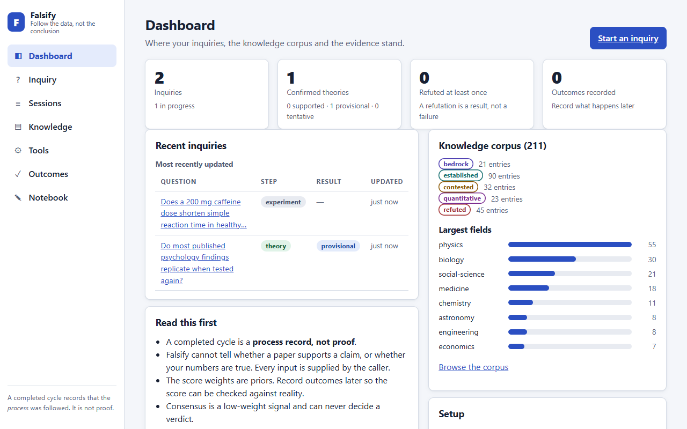
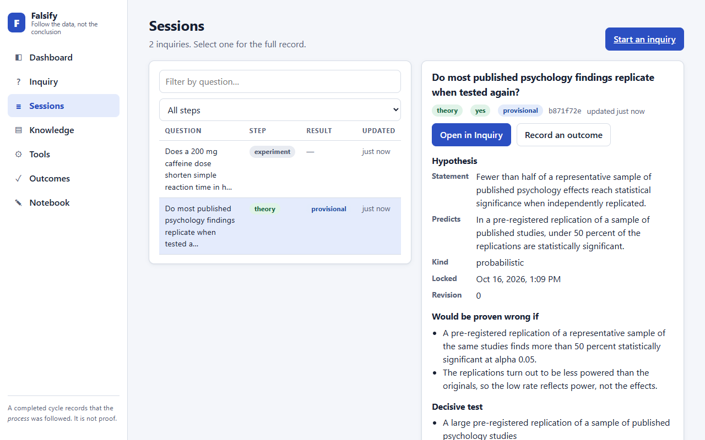

# Falsify

> Follow the data, not the conclusion.

Falsify is a reasoning tool that refuses to just hand you an answer. It runs
scientific questions through the **Cycle of Scientific Enterprise** and returns
*falsifiable hypotheses with their test conditions* — not opinions, not consensus,
not "the science is settled."

It is built on two ideas:

- **The Cycle of Scientific Enterprise** — science is a *loop, not a line*, and the
  most important move is the **"No" branch**, where data that disagrees with a
  prediction sends you back to question your methods, your hypothesis, and finally
  the theory itself.
- **Layered, weighted knowledge** — claims are grounded in tiers (Bedrock laws →
  Established theory → Contested explanations) with mandatory probability checks,
  and **consensus carries low weight by design**: we demand the receipts rather than
  reflexively accepting *or* rejecting what's popular.



📄 **New here? Start with the [user guide](./docs/USER-GUIDE.md)**, a step-by-step tour of the
app. See **[DESIGN.md](./DESIGN.md)** for the full architecture, and
**[docs/CAPABILITIES.md](./docs/CAPABILITIES.md)** for everything Falsify can and cannot do:
every tool, every rule that can refuse you, every setting and command. That file is
checked by a test against the code, so it cannot silently go stale. Agents should start
with **[AGENTS.md](./AGENTS.md)**.

---

## Use Falsify inside your agent (MCP)

Falsify ships as an MCP server exposing ten discipline-enforcing tools —
`falsify_intake`, `falsify_hypothesize`, `falsify_experiment`, `falsify_analyze`,
`falsify_review`, `falsify_recall`, plus `falsify_related` (which knowledge tiers a
claim touches, with semantic matching when the corpus is reachable), `falsify_dissent`
(compare competing hypotheses from several models and surface where they disagree,
never picking a winner), `falsify_verify_source` (confirm that a DOI you cite as
evidence is a real publication) and `falsify_outcome` (record later whether a
confirmed theory held up or was refuted, so the score can be checked against reality;
`npm run calibrate:outcomes` reports on the log). They never generate an answer; they take your
draft, run it through the cycle, and **refuse** anything that breaks the rules (a
hypothesis with no falsification condition, an experiment that cannot fail, a Yes
that skipped review).

Build it, then register the stdio server with your MCP host:

```bash
npm install
npm run build
```

VS Code (`.vscode/mcp.json`) or any MCP host:

```json
{
  "servers": {
    "falsify": {
      "command": "node",
      "args": ["dist/src/mcp/server.js"],
      "env": { "OPENBRAIN_KEY": "<your-key>" }
    }
  }
}
```

This workspace already includes a local MCP registration at
`.vscode/mcp.json`. If you also use other MCP servers in this repo, keep all of
them under the same top-level `servers` object rather than replacing the file.

`OPENBRAIN_KEY` is optional and only enables `falsify_recall` (semantic recall from
the OpenBrain corpus), semantic matching in `falsify_related`, and writing surviving theories to the corpus; the reasoning
tools work without it. The key is read from the environment and is never stored in
the repo.

### How a run is enforced

`falsify_intake` returns a `sessionId`; pass it to every later call. The server then
tracks the cycle itself, so you cannot skip a step, confirm a theory that never had a
recorded "yes", or revise a refuted hypothesis without saying what changed (and
without keeping every earlier falsification condition). Refuted hypotheses are
written to the notebook and struck through; theories that survive are recorded in the
notebook and, if `OPENBRAIN_KEY` is set, the corpus. Session state and the notebook
live under `.falsify/` (git-ignored); set `FALSIFY_DATA_DIR` to keep them elsewhere. Every
result names the `next` tool and repeats the `sessionId`, and a step without a session
carries a `sessionWarning`. If your host keeps dropping the session, set
`FALSIFY_REQUIRE_SESSION=1` in the server's environment and any step after intake
without one is refused with `session:required`. The claim-score weights can be retuned
with `FALSIFY_WEIGHTS` (for example `{"evidence":0.9,"consensus":0.05}`); a setting that
stops consensus being the smallest weight is rejected at startup. For paraphrase-proof
knowledge matching, point `FALSIFY_EMBEDDINGS_URL` at any OpenAI-compatible embeddings
endpoint (a local Ollama, `http://127.0.0.1:11434/v1`, with `nomic-embed-text` keeps
claims on your machine; set `FALSIFY_EMBEDDINGS_MODEL`, `FALSIFY_EMBEDDINGS_KEY` and
`FALSIFY_EMBEDDINGS_THRESHOLD` as needed). It is off by default, so nothing is sent
anywhere unless you set it. `npm run calibrate` scores the labelled cases in
`calibration/cases.json` and reports how well the claim score separates results that
held up from results that were refuted; `npm run calibrate:replication` refits the
statistical-support model to the real Reproducibility Project: Psychology outcomes. For
an advisory second opinion on falsifiability, appeals to authority and whether a cited
paper's abstract reports your observation, set `FALSIFY_JUDGE_URL` (and
`FALSIFY_JUDGE_MODEL`, default `qwen2.5:32b`) to an OpenAI-compatible chat endpoint such as
a local Ollama; it never changes a verdict or score, and `npm run calibrate:judge` measures
how good a given model actually is before you trust it. After
rebuilding, reload the `falsify` server in your MCP host (in VS Code, restart it from
the MCP servers list) so it picks up new tools; a running server keeps the old build.
See [DESIGN.md](./DESIGN.md) §3. Every setting (`FALSIFY_KNOWLEDGE_DIR`, `FALSIFY_JUDGE_KEY`,
`FALSIFY_BRAIN_PROJECT`, `OPENBRAIN_REST_BASE` and the rest) is listed in
[docs/CAPABILITIES.md](./docs/CAPABILITIES.md#settings-environment-variables).

### Guidance for agents that use Falsify

The tools check what an agent submits, so the agent's inputs matter. This repo ships
guidance for them: `.github/instructions/falsify-inquiry.instructions.md` (rules and
temper guards: never invent a statistic or DOI, search before disclosing, hold both sides
to the same standard), the `falsify-inquiry` skill (the step-by-step procedure, including
running the opposite framing with `mirrorOf`), a **Falsify Reviewer** agent (an
independent audit of a finished session) and a `/falsify-inquiry` prompt. To use them in
another project, copy the instructions file and the skill folder into that project's
`.github`. `npm run eval:inquiry` measures whether the guidance changes agent behaviour: it runs
the questions in `calibration/inquiry-questions.json` through a Copilot CLI agent with and
without the guidance and scores each run from the server's own session records. It
spends real model credits and its samples are small, so read it as a sketch, not a
measurement. One full run (8 questions, one model, one run per cell): the opposite
framing was completed in 7 of 8 guided runs and 0 of 8 unguided; web searches 35 versus 2;
sources verified 26 versus 13; search descriptions averaged about 51 words versus 15;
contrary results reported and invented replication claims were about equal (9 versus 9,
and none). Guided runs cost roughly twice as much because they run two inquiries. The one
guided run that skipped the mirror recorded a "no" for a thin search and said so.

## Run the Falsify web UI

The same transport-free core is also exposed over a local web dashboard. Seven screens:
**Dashboard** (where inquiries, corpus and evidence stand), **Inquiry** (the guided cycle,
including opposite-framing links, structured evidence and live DOI checks), **Sessions**
(the full record behind every result), **Knowledge** (browse and search the corpus, with
what each entry rests on and what would falsify it), **Tools** (related, verify source,
dissent), **Outcomes** (record what later happened, to check the score against reality)
and the **Notebook** (a refuted hypothesis is struck through and dated, never deleted).
It talks to the *same* `op*` operations the MCP tools call, so neither transport can
weaken the honesty rules, and it shares sessions with the MCP server. The
[user guide](./docs/USER-GUIDE.md) walks through each screen.



The screenshots in the docs are generated, not hand-made: `npm install --no-save playwright-core`
then `npm run docs:screenshots` rebuilds them from a throwaway server and demo data.

```bash
npm install
npm run build
npm run web
```

Then open the printed URL (default <http://127.0.0.1:4319>). The server binds to
`127.0.0.1` only — it is a single-user local tool, with no authentication. It answers
only to `localhost`/`127.0.0.1` host names and rejects cross-origin and non-JSON
writes, so a web page you happen to visit cannot drive it (DNS rebinding / CSRF).
Override the port with `FALSIFY_WEB_PORT`:

```bash
FALSIFY_WEB_PORT=8080 npm run web
```

As with the MCP server, `OPENBRAIN_KEY` is optional and only enables recall. No web
framework or bundler is used: the API is plain `node:http` and the front-end is
hand-authored static assets served from `public/`.

## Maintain the knowledge corpus

The tier files under `knowledge/*.yaml` are the canonical knowledge base. OpenBrain
is only a searchable mirror. That means every maintenance workflow is designed as:

1. write or update YAML
2. validate the corpus
3. optionally mirror the result to OpenBrain

The repository now includes a knowledge-maintenance CLI:

```bash
npm run knowledge -- lint
npm run knowledge -- sync --dry-run
npm run knowledge -- template --tier contested
```

Common workflows:

```bash
# scaffold a starter shape for a new entry
npm run knowledge -- template --tier bedrock

# add a new entry from YAML or JSON
npm run knowledge -- add --tier established --entry-file knowledge/examples/established-example.yaml

# add or update without deciding first which one applies
npm run knowledge -- upsert --tier quantitative --entry-file knowledge/examples/quantitative-example.yaml

# move an existing entry between tiers
npm run knowledge -- move --id established.physics.some_law --to bedrock

# mirror the current YAML corpus to OpenBrain after changes
npm run knowledge -- sync
```

Example entry files live in `knowledge/examples/` for each tier. Start from those
or from the `template` command instead of hand-remembering the schema.

Operational rule: do not treat OpenBrain as a second source of truth. If OpenBrain
sync fails, the YAML corpus is still authoritative and recoverable from git.

---

> "The first principle is that you must not fool yourself — and you are the easiest
> person to fool." — Richard Feynman

## Status

Working and in active use, still iterating. Ten MCP tools and a local web UI sit on one
transport-neutral core, with a 211-entry tiered knowledge corpus. Be clear about what it
is: it enforces discipline on what an agent *submits*, and records a **process**, not
proof. It cannot tell whether a paper supports a claim or whether the numbers are true,
its score weights are priors that real recorded outcomes have not yet calibrated, and its
keyword checks miss phrasing they were not written for. The full list of limits is in
[docs/CAPABILITIES.md](./docs/CAPABILITIES.md#what-falsify-cannot-do).
