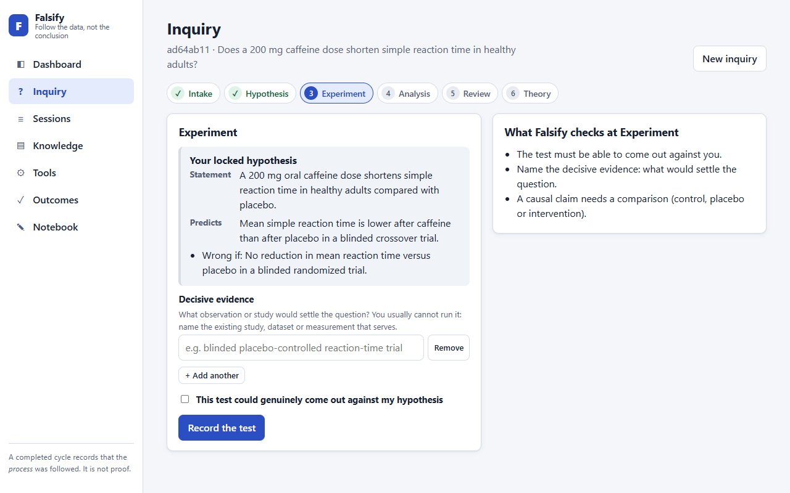
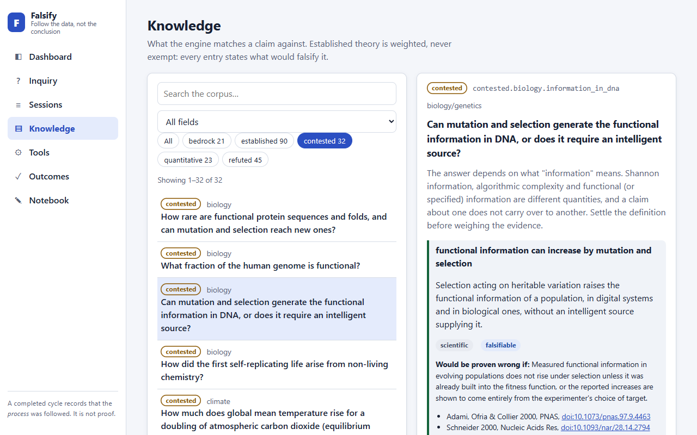
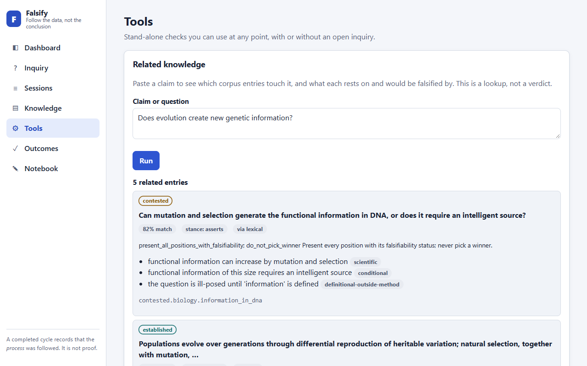

# Falsify user guide

How to use Falsify, step by step. For the complete list of tools, rules and settings, see
[CAPABILITIES.md](./CAPABILITIES.md). Every screenshot below was captured from the running app by
`npm run docs:screenshots`, using a throwaway data folder, so none of it comes from real use.

## What it does, in one minute

You bring a question or a claim. Falsify walks it through five steps (intake, hypothesis,
experiment, analysis, review) and checks that each one is done properly. It **refuses the common
shortcuts**: a hypothesis nothing could disprove, a test that cannot fail, a "yes" that skipped
review, a statistic with no stated count of outcomes tested. It can't spot every flawed method,
because it works from what you tell it. It does not answer the question for you, and it does not
decide what is true. What you get is a record of whether the process was followed, and an honest
rating of how strong the evidence you supplied is.


## The idea behind it

People reach conclusions first and look for support afterwards. Falsify turns that around by
making you commit to how your claim could fail **before** you look at the evidence, then holding
you to it. Three rules do most of the work:

- **A claim must be able to lose.** If no possible result would count against it, it is not a
  testable claim, so Falsify won't take it as one. You have to name, in advance, what would prove
  you wrong.
- **A wrong guess is useful.** When the data disagrees with you, you go back and ask whether the
  test was sound, whether the claim was wrong, or whether the theory behind it is. You may not
  save the claim by quietly narrowing it until it can't fail.
- **"Experts agree" is not evidence.** Consensus counts for the least of anything Falsify
  weighs, and it can never decide a verdict. This is not a claim that experts are usually wrong.
  Established science gets real weight, but it has to say what it rests on and what would
  overturn it, the same as anything that challenges it.

## Words you will see

| Word | Plain meaning |
|---|---|
| **Inquiry** | One question you take through the five steps. Also called a session. |
| **Falsifiable** | Something observable could prove it wrong. "Caffeine speeds up reactions" is; "everything happens for a reason" is not. |
| **Falsifier** | A specific result that would prove your claim wrong, stated before you test it. |
| **Hypothesis** | Your claim, plus what you expect to see if it is right. Once locked it can't be edited, only revised after a refutation. |
| **Evidence** | What you observed or a study reported, with its source and (if the source gives them) its numbers. |
| **Refuted** | The data disagreed with the prediction. A normal, useful outcome. |
| **Opposite framing** | The same question asked the other way ("does it raise?" against "does it lower?"), so both sides get tested alike. |
| **Corpus / knowledge library** | The built-in collection of established facts, open disputes and abandoned ideas that Falsify matches your claim against. |
| **Tier** | Which kind of entry it is: Bedrock (established laws), Established (well-supported theory), Contested (open disputes), Quantitative (statistics reminders) or Refuted (abandoned ideas). |
| **DOI** | A permanent identifier for a published paper, like `10.1126/science.aac4716`. |
| **Outcome** | What later happened to a theory you confirmed: it held up, was refuted, or is still unsettled. |
| **Status** | How much to trust a finished theory: `supported`, `provisional` or `tentative` (explained below). |
| **Statistically significant / p-value** | A p-value is a number between 0 and 1 that studies report. Roughly: how surprising the result would be if there were really no effect. Below 0.05 is the usual bar for "statistically significant". Falsify takes the number from your source and never works it out itself. |
| **Effect size** | How big the difference was, not just whether one exists. |
| **Replication** | Another, independent group repeating a study and getting the same kind of result. |
| **Pre-registered** | The researchers wrote down their method and prediction before collecting data, so they couldn't change it to fit the results. |
| **Crossref** | A free public index of published papers. Falsify asks it whether a DOI is real, and for the paper's title. |

## Start it

You need [Node.js](https://nodejs.org) 22.12 or newer.

```bash
npm install
npm run build
npm run web
```

Open <http://127.0.0.1:4319>. It runs only on your computer. If the page won't load, the server
isn't running: start `npm run web` and leave that terminal open. After you rebuild, stop it and
start it again, because a running server keeps the old code.

To use Falsify from an AI assistant instead (VS Code with GitHub Copilot, or any assistant that
supports MCP), see
[Use Falsify inside your agent](../README.md#use-falsify-inside-your-agent-mcp). The web app and
the assistant share the same inquiries, so one started in chat shows up in the dashboard.

## Run an inquiry

Open **Inquiry**. A stepper along the top shows where you are. Each step says what Falsify will
check before you submit.



The running example below is "Do most published psychology findings replicate when tested again?"

1. **Intake: is the question testable?** Type a question that observation could settle.
   Questions that are really about values ("is it fair?"), word definitions, or "what do experts
   think?" get flagged, with a suggestion for how to reword them. You can also link this as the
   opposite framing of an earlier inquiry (see below).
2. **Hypothesis: commit to a claim and how it could fail.** State a claim, what you expect to see
   if it is right, and at least one falsifier: a specific, measurable result that would prove you
   wrong. "If it is wrong" is refused, because it names nothing. If the claim is about
   likelihoods, a falsifier needs a number (a threshold, an effect size or a sample size).
   *Example: "Fewer than half of a representative sample of published psychology effects are
   statistically significant when replicated." Wrong if a pre-registered replication finds more
   than 50 percent significant.* Falsify also shows which library entries your claim touches.
3. **Experiment: name the test that would settle it.** Say which study or measurement would be
   decisive, and confirm it could genuinely have come out against you. You usually can't run it
   yourself, so you point to the existing study, dataset or measurement that serves. *Example: a
   large pre-registered replication of a sample of published studies.*
4. **Analysis: what did the evidence show?** Say whether the data agrees with your prediction, and
   list the evidence, each with its source. Two honesty rules apply:
   - Give numbers (sample size, p-value, effect size) only if the source reports them. Never
     estimate one. Statistics are optional: evidence with no p-value is fine, it just earns no
     statistical credit. If you do give a p-value you must also say **how many outcomes or
     comparisons were tested**, because testing twenty things and reporting the one that worked
     is how false findings are made. Falsify adjusts for that count.
   - For a "yes", describe where you searched and whether you found results that go against your
     claim, and say why the claim stands anyway.

   Next to a DOI, **Verify with Crossref** checks that the paper exists and compares its title
   with what you cite it for. That is a rough word-overlap check and can be wrong either way, so
   read the title it shows you and judge for yourself.
5. **Review: three questions.** Were the methods sound? Was the hypothesis itself wrong? Is the
   theory behind it wrong? Even a "yes" has to pass through review.

A "no" is a result, not a failure. After a "no", the Inquiry screen reopens the Hypothesis step with
your last claim filled in and a new box, **What changed, and why**. Edit the claim, explain what
the refutation taught you, and keep every earlier falsifier. Falsify refuses a revision that drops
one or doesn't say why, so a claim can't be narrowed until it survives.

## Read the result

When review completes, a confirmed theory gets a **status**, which says how much weight the
evidence you gave can bear:

| Status | Meaning |
|---|---|
| `supported` | You said an independent group replicated it, and the paper you cited for that replication exists, is a different paper, and is about the same subject. Falsify can't confirm the replication really happened; it checks the citation. |
| `provisional` | A sourced result that nobody has replicated yet. |
| `tentative` | Weak evidence, which you accepted knowingly. |

Some things hold a status down no matter how good the rest looks: you didn't run the opposite
framing, both framings came out "yes" (they can't both be right as worded), or every paper you
cited is about something unrelated to your claim. When that happens the result says why, in a
yellow "Status held back" box. A finished inquiry is **a record that the process was followed,
not proof**, and every input was supplied by you.

## Go back over past work

**Sessions** lists every inquiry. Select one for the full record: hypothesis, falsifiers, earlier
refuted attempts, evidence with verification flags, score, timeline, and the opposite-framing
comparison. "Open in Inquiry" picks up where you left off.


## Test the other side

A question can be rigged by how it is asked. So Intake lets you link an **opposite framing**: the
same question asked the other way ("does it raise reaction time?" next to "does it lower it?").
To do it, start a new inquiry and, on the Intake screen, pick your earlier inquiry in the
**Opposite framing of (optional)** dropdown. Then flip the direction of the question and keep the
rest of the wording as close as you can. Run both through the same steps. At review Falsify
compares them: did both reach "yes" (they can't both be right as worded), and did one side get
visibly less rigor than the other. A theory whose other side was never tested can't be rated
`supported`.

## Look things up

**Knowledge** is the library Falsify matches your claim against: established laws, well-supported
theory, open disputes, statistics reminders and ideas that were tested and abandoned. Every entry
says what it rests on and what would prove it wrong, including the well-established ones, because
no claim gets a pass. Open disputes list every position side by side, each marked as testable or
not, and never pick a winner.



**Tools** has three stand-alone checks that need no open inquiry:

- **Related knowledge**: which library entries touch a claim. A lookup, not a verdict.
- **Verify a source**: whether a DOI is a real publication, checked with Crossref. It cannot tell
  you whether the paper supports your claim.
- **Compare competing positions**: put two or more rival theories through the same standard. No
  winner is declared; you get what each predicts and which tests would tell them apart.



## Check the score against reality

Alongside the status, every finished inquiry gets an **evidence strength** (weak, moderate or
strong) from a scoring formula. The weights in that formula are educated guesses, not measured
facts. The way to find out whether they are any good is to come back later: on **Outcomes**,
record what happened to a confirmed theory (held up, was refuted, or still unsettled) and how you
know. Once you have at least five of each, the screen reports whether higher-rated theories really
did hold up more often. Until then it says there isn't enough data, and you should treat the
ratings as rough.

## Keep notes

**Notebook** is a log you can only add to. Refuted hypotheses and confirmed theories are written
to it automatically, and you can add your own notes. Nothing is ever deleted: a wrong entry is
struck through with a reason, so the history stays readable and honest.

## What it cannot do

- It cannot tell whether a paper actually supports your claim, or whether your numbers are true.
  It checks that a source exists and is about a related topic, nothing more.
- It finds library entries by wording, and by meaning too if you switch on the optional
  meaning-matching. It can miss a rephrased claim and occasionally match the wrong entry, so each
  match shows its score and how it was found.
- The library is broad but not complete, and thin in computer science, chemistry, geology and
  engineering. No match does not mean nothing relevant exists.
- The scoring weights are untested guesses until you have recorded enough outcomes.

## Troubleshooting

| Symptom | Fix |
|---|---|
| Browser says connection refused | The web server is not running. Run `npm run web`. |
| The page is blank or looks old | Hard-refresh (Ctrl+Shift+R). After a rebuild, restart `npm run web`. |
| Port 4319 is in use | Set `FALSIFY_WEB_PORT` to another port. |
| Agent tools are missing or outdated | Rebuild, then restart the `falsify` server in your MCP host. |
| "Not verified" on a real DOI | Crossref may be unreachable or rate-limiting; try again. |
| You want a clean slate | Stop the server, then delete `.falsify/sessions`, `.falsify/notebook` and `.falsify/outcomes` (or the same folders under `FALSIFY_DATA_DIR`). This permanently erases your inquiries, notes and recorded outcomes, so copy the folder first if you might want them back. |
